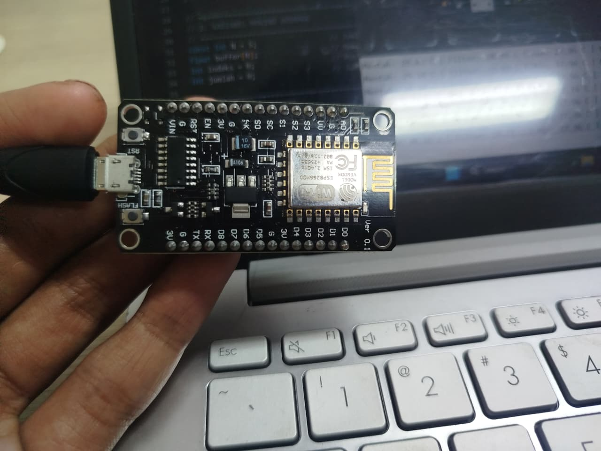
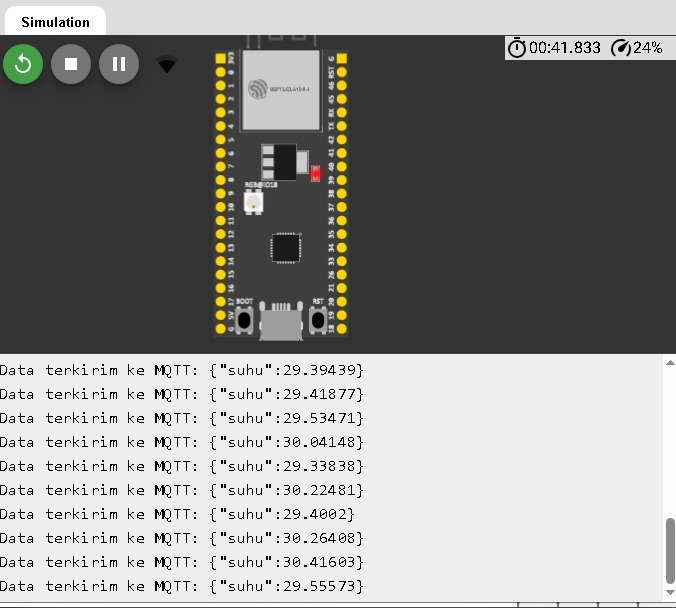
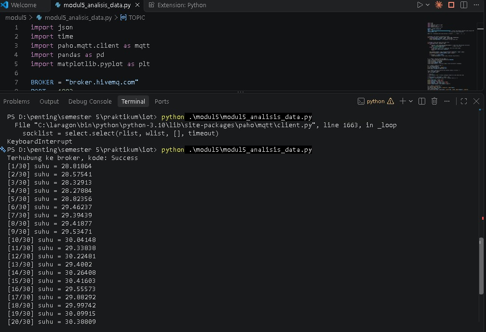
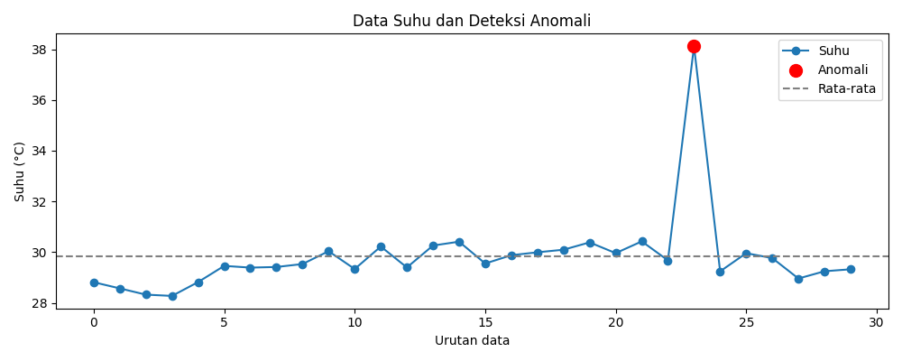

# Skematik/diagram rangkaian


# Library atau dependencies yang diperlukan
## Percobaan 5A — ESP32
- DHT.h: membaca data suhu dari sensor DHT22.
- math.h: menyediakan fungsi matematika, seperti sqrt() untuk menghitung akar kuadrat pada simpangan baku.
- Serial: menampilkan hasil pembacaan dan pengolahan data pada Serial Monitor (tersedia melalui Arduino framework).
## Percobaan 5B — Python
- json: mengubah payload JSON MQTT menjadi data yang dapat dibaca Python.
- time: mencatat waktu penerimaan data.
- paho-mqtt: menghubungkan Python ke broker MQTT dan menerima data sensor.
- pandas: mengolah data, menghitung statistik, dan menyimpan data ke CSV.
- matplotlib.pyplot: membuat grafik suhu dan menandai anomali.
# Penjelasan kode
## kode percobaan 5A
Kode percobaan 5A menggunakan sensor DHT22 untuk membaca suhu melalui ESP32. Data suhu diolah menggunakan metode moving average dengan jendela lima pembacaan agar hasil lebih stabil. Program juga mencatat suhu minimum dan maksimum, mengabaikan pembacaan yang gagal, serta menampilkan hasil setiap dua detik melalui Serial Monitor.
## kode percobaan 5B
Kode percobaan 5B menggunakan Python untuk menerima data suhu dari ESP32 melalui MQTT. Data disimpan ke dalam file CSV, kemudian dianalisis untuk mendapatkan nilai rata-rata, standar deviasi, suhu minimum dan maksimum, serta mendeteksi anomali menggunakan metode Z-score. Hasil analisis divisualisasikan dalam grafik dan disimpan sebagai file gambar.
# Penjelasan setiap fungsi

- setup()               :Dijalankan sekali ketika ESP32 mulai menyala untuk inisialisasi sensor dan Serial Monitor.
- loop()                :Dijalankan berulang untuk membaca sensor dan mengolah data suhu.
- hitungMovingAverage() :	Menghitung rata-rata pembacaan suhu yang tersimpan dalam buffer.
- on_connect()          :Menangani koneksi MQTT dan berlangganan ke topik data.
- on_message()          :Memproses pesan MQTT, memvalidasi data, dan menyimpan pembacaan suhu ke daftar.
- pd.DataFrame()        :Mengubah daftar data menjadi struktur tabel pandas.
- to_csv()	            :Menyimpan tabel data ke file CSV.
- plt.plot()	        :Membuat grafik garis data suhu.
- plt.scatter()	        :Memberikan penanda pada titik data yang terdeteksi sebagai anomali.
# Penjelasan percabangan/conditional
## Percobaan 5A:
- if (isnan(suhu)) memeriksa apakah pembacaan sensor tidak valid. Jika ya, data diabaikan.
- if (jumlah < N) memastikan jumlah sampel tidak melebihi kapasitas jendela sebelum buffer terisi penuh.
- if (suhu < suhuMin) memperbarui suhu minimum jika ditemukan nilai lebih rendah.
- if (suhu > suhuMax) memperbarui suhu maksimum jika ditemukan nilai lebih tinggi.
## Percobaan 5B:
- try-except menangani kesalahan saat membaca JSON atau mengubah suhu menjadi angka, sehingga data tidak valid dapat diabaikan.
- if len(data) >= JUMLAH_SAMPEL menghentikan pengumpulan setelah 30 sampel diterima.
- if std == 0 mencegah pembagian dengan nol ketika seluruh data memiliki nilai sama.
- df["zscore"].abs() > 2 menandai data yang nilai absolut Z-score-nya lebih besar dari 2 sebagai anomali.
# Penjelasan singkat mengenai detail percobaan
### Percobaan 5A 
Percobaan ini mengimplementasikan edge processing, yaitu pengolahan data langsung pada ESP32. Sensor DHT22 membaca suhu setiap dua detik, kemudian program menghitung moving average dari lima pembacaan terakhir dan memperbarui suhu minimum serta maksimum. Hasilnya ditampilkan pada Serial Monitor untuk membandingkan data mentah dengan data hasil filter.   
### Percobaan 5B 
Percobaan ini mengimplementasikan pengolahan data pada komputer menggunakan Python. Data suhu diterima melalui MQTT sebanyak 30 sampel, disimpan dalam file data_suhu.csv, dianalisis menggunakan statistik deskriptif dan Z-score, kemudian divisualisasikan menjadi grafik grafik_suhu.png.

# Jawaban pertanyaan praktikum yang berkaitan dengan code
## Pertanyaan 5.5.4 No 4
```cpp

#include <DHT.h>
#include <math.h>

#define DHTPIN 4
#define DHTTYPE DHT22

DHT dht(DHTPIN, DHTTYPE);

const int N = 5;
float buffer[N];
int indeks = 0;
int jumlah = 0;

float suhuMin = 1000.0;
float suhuMax = -1000.0;

float hitungMovingAverage(float nilaiBaru) {
    buffer[indeks] = nilaiBaru;
    indeks = (indeks + 1) % N;

    if (jumlah < N) {
        jumlah++;
    }

    float total = 0;
    for (int i = 0; i < jumlah; i++) {
        total += buffer[i];
    }

    return total / jumlah;
}

float hitungSimpanganBaku() {
    if (jumlah < 2) {
        return 0.0;
    }

    float total = 0;
    for (int i = 0; i < jumlah; i++) {
        total += buffer[i];
    }

    float rata2 = total / jumlah;

    float jumlahKuadrat = 0;
    for (int i = 0; i < jumlah; i++) {
        float selisih = buffer[i] - rata2;
        jumlahKuadrat += selisih * selisih;
    }

    return sqrt(jumlahKuadrat / jumlah);
}

void setup() {
    Serial.begin(115200);
    dht.begin();
}

void loop() {
    float suhu = dht.readTemperature();

    if (isnan(suhu)) {
        Serial.println("Pembacaan gagal, data diabaikan");
    } else {
        float suhuFilter = hitungMovingAverage(suhu);
        float simpanganBaku = hitungSimpanganBaku();

        if (suhu < suhuMin) {
            suhuMin = suhu;
        }

        if (suhu > suhuMax) {
            suhuMax = suhu;
        }

        Serial.print("Mentah: ");
        Serial.print(suhu);

        Serial.print(" | Filter: ");
        Serial.print(suhuFilter);

        Serial.print(" | Std Dev: ");
        Serial.print(simpanganBaku);

        Serial.print(" | Min: ");
        Serial.print(suhuMin);

        Serial.print(" | Max: ");
        Serial.println(suhuMax);
    }

    delay(2000);
}

```

Penjelasan: 
Program menghitung rata-rata data dalam buffer, menghitung kuadrat selisih setiap data terhadap rata-rata, kemudian mengambil akar dari rata-rata kuadrat selisih tersebut. Perhitungan menggunakan simpangan baku populasi, yaitu pembagi jumlah, bukan jumlah - 1.
## Pertanyaan 5.6.4 No 4
```cpp
# Menghitung moving average dengan jendela 5 data
df["suhu_ma5"] = df["suhu"].rolling(
    window=5, min_periods=1
).mean()

# Menghitung z-score data mentah
rata2 = df["suhu"].mean()
std = df["suhu"].std()

if std == 0:
    df["zscore_mentah"] = 0.0
else:
    df["zscore_mentah"] = (df["suhu"] - rata2) / std

df["anomali_mentah"] = df["zscore_mentah"].abs() > 2

# Menghitung z-score data hasil moving average
rata2_ma = df["suhu_ma5"].mean()
std_ma = df["suhu_ma5"].std()

if std_ma == 0:
    df["zscore_ma"] = 0.0
else:
    df["zscore_ma"] = (
        df["suhu_ma5"] - rata2_ma
    ) / std_ma

df["anomali_ma"] = df["zscore_ma"].abs() > 2

# Membandingkan jumlah anomali
print("Anomali data mentah:",
      df["anomali_mentah"].sum())

print("Anomali setelah moving average:",
      df["anomali_ma"].sum())
```

penjelasan kode
- rolling(window=5, min_periods=1).mean() menghitung rata-rata bergerak dari maksimal lima data terakhir. Pada awal data, rata-rata dihitung menggunakan sampel yang tersedia.
- zscore_mentah menghitung Z-score berdasarkan data suhu asli.
- zscore_ma menghitung Z-score berdasarkan data yang sudah difilter.
- anomali_mentah dan anomali_ma menandai data dengan nilai absolut Z-score lebih dari 2.
- sum() menghitung jumlah data yang terdeteksi sebagai anomali untuk masing-masing metode.
# dokumentasi




 
